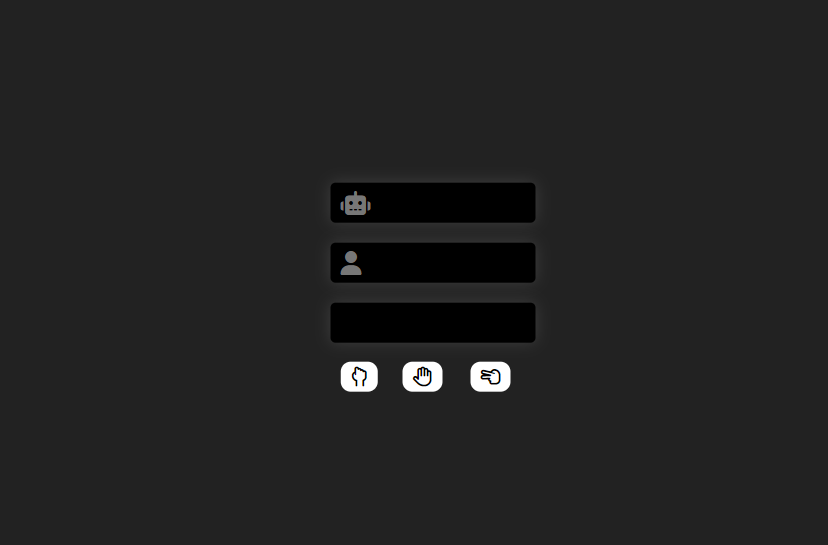

# Rock Paper Scissors 🪨📄✂️

A classic Rock Paper Scissors game played against the computer, built with HTML, CSS and vanilla JavaScript. Pick Rock, Paper or Scissors and the bot randomly generates its own choice — the result is shown instantly with color-coded win/lose/draw feedback.


## ✨ Features

- 🤖 Play against a bot that picks a random choice each round
- 🎨 Color-coded results — green glow for **win**, red for **lose**, neutral for **draw**
- 🖱️ One-click buttons for Rock, Paper and Scissors with Font Awesome hand icons
- 🌑 Dark UI with glowing cards and smooth hover transitions
- ⚡ Real-time updates of the player choice, computer choice and result

## 🛠️ Tech Stack

- **HTML5** — game markup
- **CSS3** — dark theme, glow effects & transitions
- **JavaScript (ES6)** — game logic, `Math.random()` bot & DOM updates
- **Font Awesome 6** (CDN) — robot, user & hand gesture icons

## 📂 Project Structure

```
├── index.html              # Game UI + embedded styles
├── main.js                 # Game logic (choices, results, feedback)
└── projectImages/
    └── Screenshot.png      # Game preview
```

## 🚀 Getting Started

1. Clone the repository:
   ```bash
   git clone https://github.com/shena9y/rockPaperScissers.git
   ```
2. Open `index.html` in your browser.
3. Click **Rock**, **Paper** or **Scissors** and see if you can beat the bot! 🤖

## 📸 Screenshot



## 📝 License

Distributed under the MIT License. See `LICENSE` for more information.
